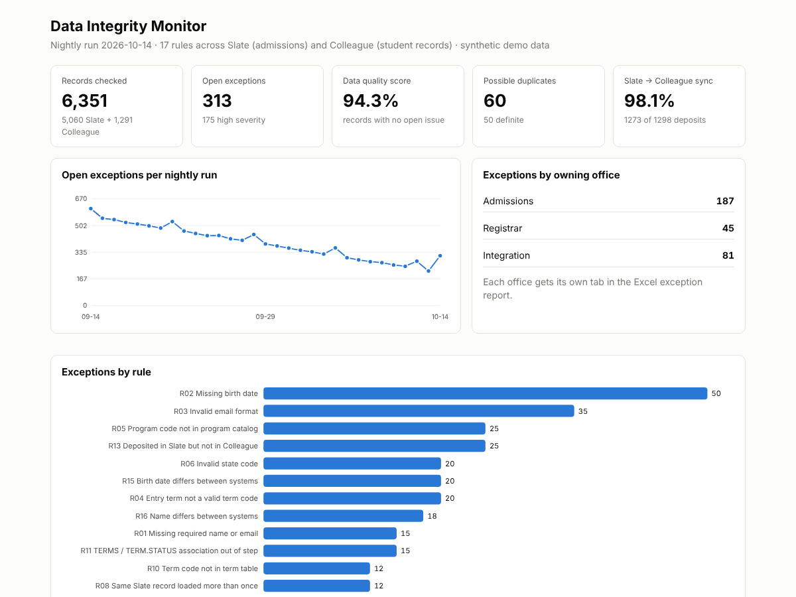

# Higher-Ed Data Integrity Monitor

A nightly job that checks whether a university's admissions data and student records agree, and tells each office what to fix.

Most colleges run two systems side by side. Admissions works in a CRM such as **Technolutions Slate**. Once a student deposits, their record is supposed to flow into the student information system, usually **Ellucian Colleague**, which stores its data in a **UniData MultiValue** database. Records get lost on the way, names and birth dates drift apart, and the same applicant ends up in Slate twice. This project finds those problems before they reach registration, financial aid or IPEDS reporting.

All data here is synthetic. The generator plants a known set of problems and saves an answer key, so the pipeline's accuracy is measured, not assumed.



## What it does

1. **Reads both systems.** A Slate-style CSV export, and a Colleague-style file in real MultiValue format: attribute marks (`char 254`), value marks (`char 253`), and Pick internal dates (days since 31 Dec 1967).
2. **Flattens MultiValue into relational tables.** Associated multivalued fields (`TERMS` and `TERM.STATUS`) become a child table, and the parser keeps a count of each side so a broken association is visible in SQL instead of silently dropped.
3. **Validates on the way in** with Pydantic: trims blanks, fixes case, accepts both `YYYY-MM-DD` and `MM/DD/YYYY` dates, strips phone formatting. Anything it can't coerce is logged as a schema error rather than crashing the load.
4. **Runs 17 SQL rules** against SQLite, grouped by the office that owns the fix:

   | Office | Rules |
   |---|---|
   | Admissions (Slate) | missing name/email, missing birth date, bad email, invalid term, program not in catalog, invalid state, implausible birth date, record loaded twice |
   | Registrar (Colleague) | missing birth date, invalid term code, `TERMS`/`TERM.STATUS` out of step, invalid status code |
   | Integration (cross-system) | deposited but never reached Colleague, Colleague student with no application, birth date mismatch, name mismatch, registered without a deposit |

5. **Finds duplicate applicants** that exact matching misses (Bill vs William, Joesph vs Joseph, a blank birth date). Jaro-Winkler and Soundex are implemented from scratch. Records are blocked by birth date, phone and Soundex so 5,000 people don't mean 12.5 million comparisons, then scored on name similarity with birth date, phone and email as corroboration. Pairs land in a **definite** or **likely** band; likely pairs go to a human review queue.
6. **Reconciles the two systems.** Sync rate for deposited students, plus field-level disagreements.
7. **Reports.** A self-contained HTML dashboard with a nightly trend, and an Excel exception report with one tab per office plus a duplicate review tab.
8. **Runs itself.** GitHub Actions runs the tests and the pipeline every night and keeps the reports as build artifacts.

## Results on the demo data

One run at 5,000 applicants:

| | |
|---|---|
| Records checked | 6,351 (5,060 Slate applicants + 1,291 Colleague students) |
| Open exceptions | 313, of which 175 high severity |
| Possible duplicates | 60 (50 definite, 10 likely) |
| Slate → Colleague sync | 98.1% (1,273 of 1,298 deposited students) |
| Clean records | 94.3% |
| Detection vs answer key | **373 of 373 planted issues caught, 0 false alarms** |

The test suite repeats the detection check on three different random seeds.

## Run it

```bash
pip install -r requirements.txt
python -m dim.pipeline --backfill 30     # 30 simulated nights, then today's run
python -m unittest discover -s tests -t .
```

Open `output/dashboard.html` in a browser. The Excel report is next to it.

Useful flags: `--n 20000` for more records, `--error-rate 2` for messier data, `--no-generate` to run on files already in `data/`.

## Layout

```
dim/
  generate.py     synthetic Slate + Colleague data with planted problems and an answer key
  multivalue.py   UniData-style record reader/writer, Pick date conversion
  models.py       Pydantic schema and normalization for the Slate export
  rules.py        the 17 SQL rules, loading into SQLite
  fuzzy.py        Jaro-Winkler, Soundex, blocking and duplicate scoring
  pipeline.py     the nightly run, metrics, answer-key evaluation, run history
  report.py       Excel exception report and HTML dashboard
tests/            22 unittest cases: parser, matcher, every rule, end to end
```

## Notes and limits

- The MultiValue file is read from a flat export. Against a live UniData server the same parser would sit behind a UniQuery `LIST` or a UniObjects connection.
- Real Slate and Colleague schemas are much larger; this models only the fields the rules need.
- Planted problems are cleaner than real-world ones, so the 100% detection figure says the rules do what they claim, not that they would catch every real defect.
